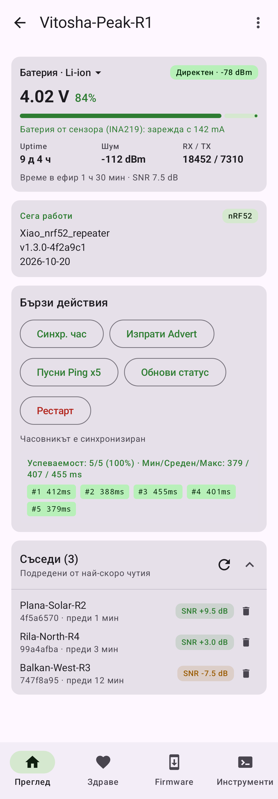
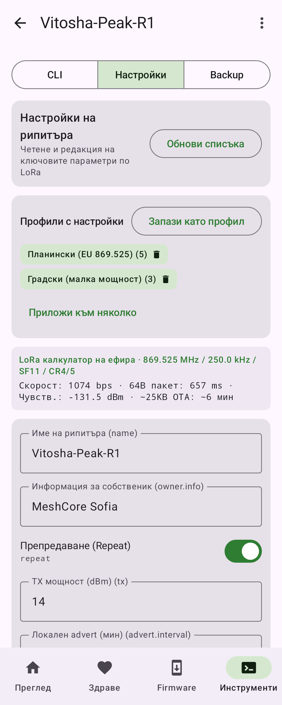
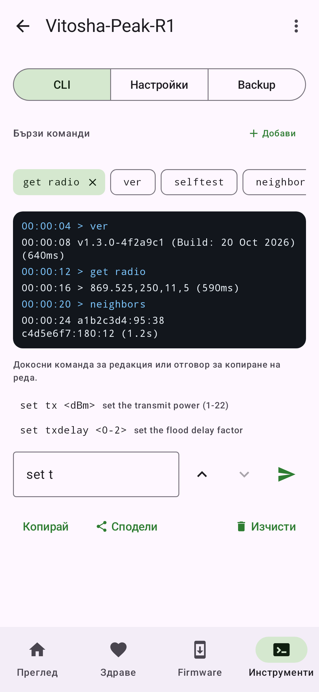
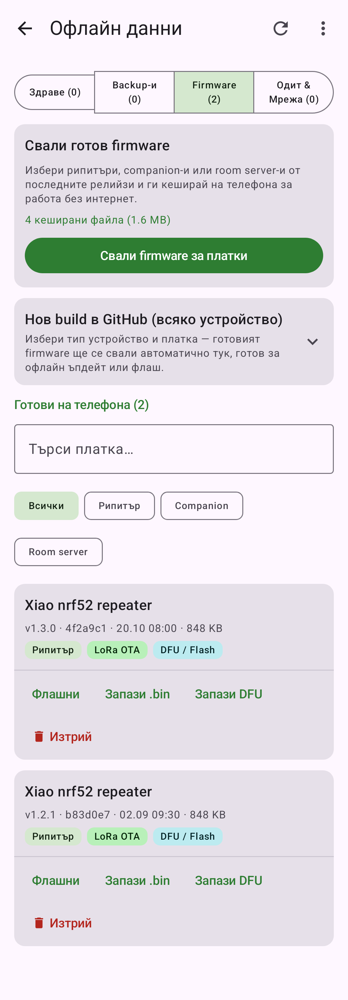
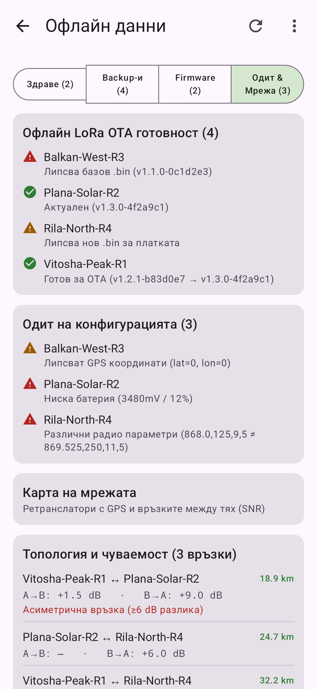
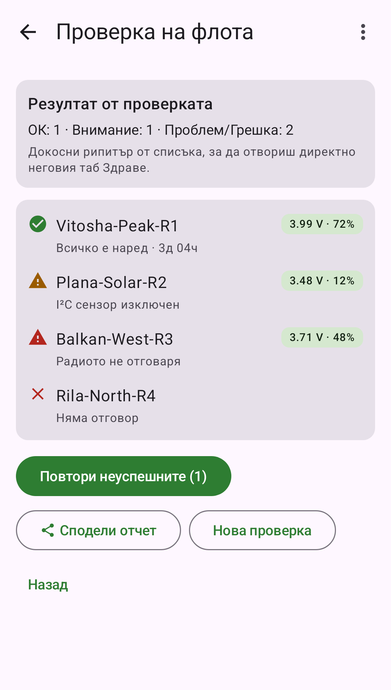
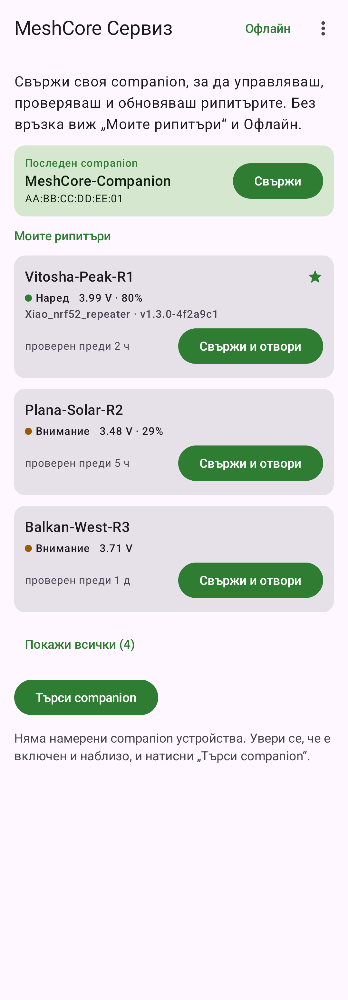
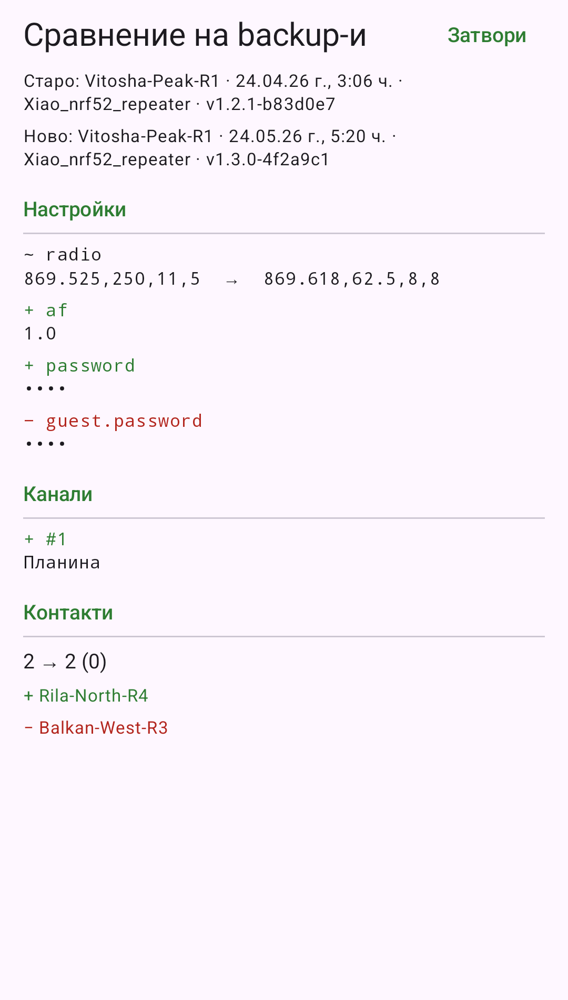
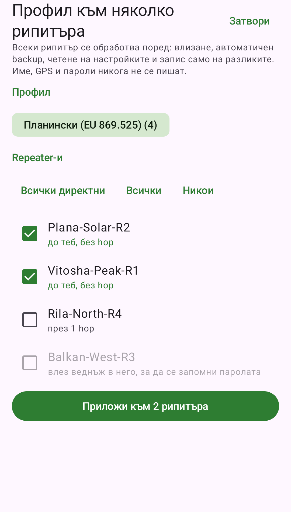
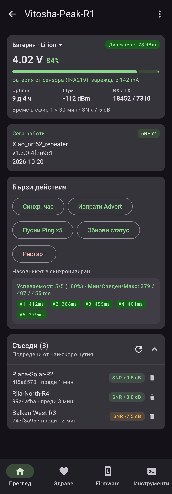

# LoRa OTA Android приложение — Ръководство и функции

Android приложението в [`android/`](../android) служи за безжично обновяване (LoRa делта OTA, Bluetooth DFU и ESP32 Wi-Fi OTA), диагностика, конфигурация и офлайн управление на цял флот от MeshCore рипитъри, companion устройства и room сървъри.

---

## Галерия с екрани

Екраните са **истински снимки на приложението**: рендират се директно от Compose кода с [Paparazzi](https://github.com/cashapp/paparazzi) върху демонстрационни данни (измислени имена като `Vitosha-Peak-R1`) и затова винаги съвпадат с приложението. Обновяват се с `tools/android-screens.sh`; CI (`android-screens.yml`) ги генерира като artifact.

| Преглед на рипитър (Ping x5 & съседи) | Настройки, Профили & LoRa Airtime калкулатор | Интерактивна CLI конзола с подсказки |
| :---: | :---: | :---: |
|  |  |  |

| Офлайн Firmware хъб & Директен флаш | Офлайн Одит, Делта OTA & Мрежова топология | Пакетна проверка на флота (Health Sweep) |
| :---: | :---: | :---: |
|  |  |  |

| Начален екран „Моите рипитъри“ | Сравнение на два backup-а | Профил към няколко рипитъра |
| :---: | :---: | :---: |
|  |  |  |

| Преглед в тъмна тема |
| :---: |
|  |

---

## Основни възможности

### 1. 4-табова навигация в рипитъра (`Преглед` · `Здраве` · `Firmware` · `Инструменти`)
- **Преглед (`Overview`)**:
  - Карта със статус на батерията (избор на химия Li-ion / LiFePO4 / LTO 2S, ток от INA219/BQ25798), uptime, ниво на шума (noise floor) и брой пакети.
  - **Бързи действия (`QuickActionsCard`)**: 1-tap синхронизиране на UTC часовника директно от телефона (`time <epoch>`), изпращане на Flood Advert, обновяване на статуса, защитен рестарт и **Жив тест на обхвата (`Ping x5`)**, отчитащ успеваемост (`%`), `Мин / Среден / Макс RTT (ms)` и чипове за всеки пакет.
  - **Съседи (`NeighborsCard`)**: Автоматично разпознава 8-hex префиксите спрямо контактите, оцветява SNR баджовете, позволява изтриване на остарели записи (`neighbor.remove`) и изчислява **Haversine разстояние и компасен азимут** (напр. `14.2 km SE (138°)`) при известни GPS координати.
- **Здраве (`Health`)**:
  - Показва обобщен статус и превод на `selftest` в четим вид (радио, I2C сензори, QSPI флаш, батерия, mailbox, OTA, `battsave`).
  - Разгъваема секция **„История“** с графики по заявка (24 ч / Седмица) и бутон **„Експорт CSV“** на всяка графика.
  - Разгъваема карта за настройка на праговете за пестене на батерия (`battsave`) и капацитет в `mAh`.
- **Firmware**:
  - **По LoRa (Делта OTA)**: Изчислява компресиран делта пач между текущия и новия `.bin` и го изпраща на страничен канал при спазване на 10% ефирен лимит (с поддръжка на пауза и продължаване до 30 мин).
  - **По Bluetooth / Wi-Fi**: Пълен запис на `.zip` / `.uf2` (преобразуван автоматично в DFU `.zip` на телефона) за nRF52 или `.bin` през Wi-Fi точката `MeshCore-OTA` за ESP32.
  - Залепен (sticky) бутон **„Обнови“ / „Запиши“**, винаги видим над долната навигационна лента.
- **Инструменти (`Tools`)**:
  - **Интерактивна CLI конзола**: Работи както отдалечено към рипитъра, така и локално към companion-а (`CLI` бутон на картата на companion-а). Поддържа бързи чипове, потребителски запазени команди (с блокиране на команди, съдържащи пароли/ключове), история, autocomplete за `get`/`set`, RTT време на всеки отговор, потвърждение за опасни команди, режим за стоков companion и копиране/споделяне с автоматично маскиране на секрети (`[REDACTED]`).
  - **Визуален редактор на настройки (`RepeaterSettingsEditor`)**: Чете и записва само променените параметри, валидира стойностите на живо, попълва `lat`/`lon` с **1 докосване от GPS-а на телефона** и показва предупреждение преди смяна на `radio`.
  - **Профили с настройки (`Config Profiles`)**: Запазване на текущите настройки (или избран backup) като шаблон (без име, GPS координати и пароли) и прилагане върху друг рипитър с 1 докосване.
  - **LoRa калкулатор на ефира (`LoraRadioCalculator`)**: Показва на живо еквивалентна скорост (`bps`), ефирно време за 64 B пакет (`ms`), чувствителност (`dBm`), очаквано време за ~25 KB делта OTA (`мин`) и предупреждава при излизане извън 10% duty-cycle подлентата `869.40–869.65 MHz`.
  - **Временен радио тест (`tempradio`)**: Безопасно тестване на нови честоти/SF/BW за `N` минути с автоматично връщане към старите параметри.

---

### 2. Управление на флота и пакетна проверка (`Health Sweep`)
- **Закачане (Pin) и филтри**: Важните рипитъри се закачат със звезда най-отгоре; списъкът се филтрира с 1 докосване (`Всички` · `Директни` · `С проблем` · `Закачени`) и показва цветна точка за последно здраве и процент батерия от `HealthStore`.
- **Проверка на флота (`SweepScreen`)**: Последователно влиза в избраните рипитъри със запазени пароли (по подразбиране са отметнати само директните; преди старт показва броя и очакваното време за потвърждение), изпълнява `selftest`, по избор **синхронизира UTC часовника на всеки рипитър**, записва резултатите и генерира обобщен отчет с бутон за повторение на неуспешните и споделяне.
- **Опашка за пакетно LoRa OTA обновяване (`QueueScreen`)**: Обновява няколко директни рипитъра един след друг до избрано издание с автоматичен backup преди всеки и работа във фонов режим.

---

### 3. 4-табов Офлайн Хъб (`Офлайн данни`)
Достъпен по всяко време от началния екран и менюто без нужда от Bluetooth връзка:
1. **Здраве**: Търсачка и пълна хронология на всички запазени `selftest` проверки на телефона.
2. **Backup-и**: Търсачка, **директен импорт на външен `.json` backup файл**, **сравняване на два backup-а (Diff)** ключ по ключ, **„Запази като профил“**, криптиран експорт и преглед на настройките със скрити пароли/PIN.
3. **Firmware**:
   - **Свали готов firmware (`Подготви за терен`)**: Избор на платки (с търсачка и филтри `Рипитър | Companion | Room server`) за предварително кеширане на телефона преди излизане без интернет.
   - **Нов build в GitHub (всяко устройство)**: Стартиране на GitHub Actions build за рипитър, companion или room сървър с автоматично сваляне в кеша.
   - **Готови на телефона**: Търсене, филтриране по роля, експорт на `.bin` / DFU `.zip` файл и бутон **„Флашни“** за **директен офлайн флаш** (при свързан companion пита кое устройство да се флашне) по Bluetooth DFU (`*_OTA` / `DfuTarg`) или Wi-Fi (`MeshCore-OTA`) на терен без companion.
4. **Одит & Мрежа**:
   - **Офлайн LoRa OTA готовност (`OfflineDeltaInspector`)**: Проверява за всеки познат рипитър дали телефонът има в кеша както базовия `.bin` (за текущата версия на рипитъра), така и новия целеви `.bin`.
   - **Одит на конфигурацията и сигурността (`FleetAuditLogic`)**: Автоматично открива разминаване в `radio` параметрите спрямо флота, нулеви координати (`lat=0, lon=0`), изключено препредаване (`repeat=off`), отворен гост достъп за запис (`allow.read.only=off` без гост парола) и ниска батерия.
   - **Топология и чуваемост (`MeshGeoTopology`)**: Строи двупосочна матрица на чуваемостта (`A ↔ B`, `A→B dB` и `B→A dB`) с Haversine разстояние и сигнализира при **асиметрични връзки (`>= 6.0 dB` разлика)**.

---

### 4. Сигурност, Auto-Reconnect и Пълен Архив на Работното Място
- **Android Keystore защита (`PasswordStore` & `TokenStore`)**: Всички запазени админ пароли за рипитъри и GitHub токени се съхраняват криптирани с `AES/GCM/NoPadding` ключ в Android Keystore.
- **Пълен архив на работното място (`WorkspaceBundle`)**: От `Настройки` можеш да експортираш или възстановиш всички backup-и, здравна история, пароли за рипитъри, закачени устройства, CLI команди, конфигурационни профили и топология на съседите в един криптиран файл (`PBKDF2-HMAC-SHA256` + `AES-256-GCM`).
- **BLE Auto-Reconnect (`CompanionLink`)**: При кратко прекъсване на Bluetooth връзката приложението прави до 2 автоматични опита за повторно свързване без загуба на текущия екран.
- **Самообновяване (`AppUpdater`)**: Проверка и сваляне на нови APK версии от GitHub Releases с проверка на HTTPS, размер и SHA-256 хеш от GitHub (издание без хеш се отказва), инсталиране през системния PackageInstaller, по-стари и pre-release версии се пропускат (освен ако текущата е pre-release), и запазване на груповия токен при обновяване от Group APK.
